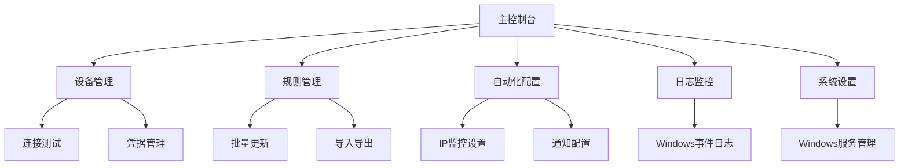

# 华为USG防火墙NAT管理软件 - 产品需求文档

## 1. 产品概述

### 1.1 产品定位

华为USG防火墙NAT管理软件是一款专为Windows桌面环境设计的自动化管理工具，旨在解决华为USG系列防火墙NAT Server规则管理的痛点。

### 1.2 核心价值

- **自动化管理**：自动检测公网IP变化并批量更新NAT规则
- **效率提升**：大幅减少手动操作时间，降低人为错误
- **业务保障**：确保业务连续性，避免IP变更导致的服务中断
- **智能运维**：友好的图形化界面，强大的自动化功能

### 1.3 目标用户

| 角色         | 使用方式       | 核心权限                               |
|--------------|----------------|----------------------------------------|
| 网络管理员   | 本地安装使用   | 完整的设备管理、规则配置、系统设置权限 |
| 运维工程师   | 本地安装使用   | 规则查看、手动更新、日志查看权限       |

## 2. 功能架构

### 2.1 功能模块概览

本软件包含六大核心页面，构建完整的NAT规则管理生态：

1. **主控制台页面** - 状态监控、快速操作、系统托盘集成
2. **设备管理页面** - 设备配置、凭据管理、连接测试
3. **规则管理页面** - 规则展示、批量编辑、导入导出
4. **自动化配置页面** - IP监控、更新策略、通知配置
5. **日志监控页面** - 操作日志、事件日志集成
6. **系统设置页面** - 服务管理、主题配置、安全设置

### 2.2 功能详细列表

| 页面               | 模块功能              | 功能说明                                             | UI特性                                   |
|--------------------|-----------------------|------------------------------------------------------|------------------------------------------|
| **主控制台**       | 状态监控面板          | 显示公网IP、设备状态、监控状态                       | 状态卡片、指示灯、托盘同步               |
|                    | 快速操作区            | 启动/停止监控、手动更新、查看日志                    | 主题色按钮、图标文字、确认对话框         |
| **设备管理**       | 设备列表管理          | 添加、编辑、删除设备，支持SSH/HTTPS                  | 表格布局、右键菜单、浮动按钮             |
|                    | 凭据安全管理          | 集成Windows凭据管理器，安全存储登录信息              | 安全输入框、加密状态显示                 |
|                    | 连接测试工具          | 实时测试设备连接，显示延迟和状态                     | 状态指示灯、延迟显示                     |
| **规则管理**       | 规则列表展示          | 表格展示NAT规则，支持搜索、筛选、排序                | 虚拟滚动表格、多选框、筛选栏             |
|                    | 设备规则同步          | 从设备拉取最新NAT规则并覆盖本地缓存                  | 进度条、结果提示                         |
|                    | 批量操作工具          | 批量更新IP地址，支持预览和确认                       | 预览面板、进度条、状态图标               |
|                    | 导入导出功能          | 规则配置导入导出，支持多种格式                       | 文件选择器、格式选项                     |
| **自动化配置**     | IP监控设置            | 配置检测间隔、检测源、变更阈值                       | 分组表单、开关控件、数值输入             |
|                    | 更新策略配置          | 设置触发条件、备份策略、回滚机制                     | 下拉选择器、策略配置                     |
|                    | 通知系统设置          | 配置Windows/邮件/微信通知                            | 通知类型选择、测试按钮                   |
| **日志监控**       | 操作日志查看          | 显示操作历史，支持级别筛选和导出                     | 时间轴布局、色彩编码、过滤工具           |
|                    | Windows事件集成       | 集成系统事件日志                                     | 事件级别筛选、搜索功能                   |
| **系统设置**       | Windows服务管理       | 管理服务状态，配置开机自启动                         | 服务控制面板、状态开关                   |
|                    | 主题显示设置          | 主题跟随、高DPI适配、Fluent Design风格               | 主题选择器、预览功能                     |

## 3. 业务流程

### 3.1 初始配置流程

用户首次使用时的配置步骤：

1. 添加防火墙设备信息（IP地址、端口、连接方式）
2. 配置登录凭据（支持密码/私钥/证书/多因子认证）
3. 测试设备连接状态
4. 从设备同步或手动导入NAT规则
5. 配置IP监控参数（检测间隔、通知方式）
6. 启用自动监控功能

### 3.2 自动更新流程

系统自动化工作流程：

1. 定时检测公网IP变化
2. 发现IP变更时触发更新流程
3. 自动备份当前NAT配置
4. 批量更新所有相关NAT规则
5. 验证更新结果
6. 发送通知报告（成功/失败/部分成功）
7. 记录操作日志

### 3.3 手动管理流程

用户手动操作场景：

1. 查看当前NAT规则列表
2. 搜索和筛选特定规则
3. 选择需要更新的规则
4. 批量修改目标IP地址
5. 预览变更内容
6. 确认并执行更新
7. 查看执行结果和日志

### 3.4 系统架构图



## 4. SSH认证功能

### 4.1 认证方式概览

本软件支持企业级SSH认证，提供四种认证方式，满足不同安全需求：

| 认证方式         | 支持状态     | 安全级别 | 企业级支持 | 适用场景               |
|------------------|--------------|----------|------------|------------------------|
| **密码认证**     | ✅ 完全支持  | 中等     | ✅ 基础    | 个人用户、快速测试     |
| **私钥认证**     | ✅ 完全支持  | 高       | ✅ 推荐    | 开发环境、高安全需求   |
| **证书认证**     | ✅ 完全支持  | 高       | ✅ 企业级  | 企业环境、生产系统     |
| **多因子认证**   | ✅ 完全支持  | 最高     | ✅ 企业级  | 关键系统、合规要求     |

### 4.2 认证方式详解

#### 4.2.1 密码认证（Password Authentication）

**功能描述：**  
传统的用户名密码认证方式，简单易用，适合个人用户和快速测试场景。

**技术实现：**
- 用户名/密码输入，AES-256-GCM加密存储
- 集成Windows凭据管理器

**使用场景：** 个人用户日常使用、开发环境快速测试、低风险系统访问

**配置示例：**
```
认证类型: 密码认证
用户名: admin
密码: ******** (加密存储)
```

#### 4.2.2 私钥认证（Private Key Authentication）

**功能描述：**  
使用SSH密钥对进行认证，无需传输密码，安全性高，适合开发者和高安全需求场景。

**技术实现：**
- 支持RSA、DSA、ECDSA、Ed25519密钥
- 支持私钥密码保护（Passphrase）
- 支持OpenSSH、PEM、PuTTY PPK格式

**使用场景：** 开发服务器访问、自动化脚本执行、无人值守操作、CI/CD流程集成

**配置示例：**
```
认证类型: 私钥认证
用户名: admin
私钥路径: C:\Users\admin\.ssh\id_rsa
私钥密码: ******** (可选，加密存储)
```

#### 4.2.3 证书认证（Certificate Authentication）

**功能描述：**  
使用X.509证书进行认证，支持企业PKI基础设施，适合企业环境和生产系统。

**技术实现：**
- X.509证书支持、证书链验证
- CRL/OCSP证书吊销检查
- 企业CA集成

**使用场景：** 企业生产环境、统一身份认证、合规性要求、PKI基础设施

**配置示例：**
```
认证类型: 证书认证
用户名: admin
证书路径: C:\Certs\admin.crt
私钥路径: C:\Certs\admin.key
CA证书路径: C:\Certs\ca.crt (可选)
```

#### 4.2.4 多因子认证（Multi-Factor Authentication）

**功能描述：**  
结合多种认证方式，提供最高级别的安全保护，适合关键系统和合规要求场景。

**技术实现：**
- 密码 + 私钥组合认证
- MFA令牌验证（支持TOTP/SMS/Email/Hardware）
- 分步认证流程

**支持的MFA类型：**

| MFA类型      | 说明                                                     | 适用场景     |
|--------------|----------------------------------------------------------|--------------|
| **TOTP**     | 时间同步令牌（Google Authenticator、Microsoft Authenticator） | 通用场景     |
| **SMS**      | 短信验证码                                               | 移动用户     |
| **Email**    | 邮件验证码                                               | 企业用户     |
| **Hardware** | 硬件令牌（YubiKey、FIDO2）                               | 高安全需求   |

**配置示例：**
```
认证类型: 多因子认证
用户名: admin
密码: ******** (第一因子)
私钥路径: C:\Users\admin\.ssh\id_rsa (第二因子，可选)
MFA类型: TOTP
MFA令牌: 123456 (第三因子)
```

### 4.3 安全特性

#### 4.3.1 加密存储

**凭据保护：**
- AES-256-GCM加密算法、Windows DPAPI集成
- 内存安全解密、自动清理敏感数据

**密钥管理：**
- Windows凭据管理器集成、密钥文件权限检查
- 密钥内容加密缓存、定期密钥轮换提醒

#### 4.3.2 认证与会话安全

**连接安全：**
- SSH协议2.0、强加密算法（AES-256、ChaCha20）
- 主机密钥验证、中间人攻击防护

**会话安全：**
- 会话超时自动断开、空闲连接自动关闭
- 重连时重新认证、审计日志记录

**访问控制：**
- 用户权限分离、操作审计日志
- 设备访问策略、时间窗口限制

**合规性：**
- 操作全程记录、敏感操作审批
- 密码策略强制、定期安全审计

### 4.4 用户界面设计

#### 4.4.1 认证方式选择

**智能表单特性：**
- 下拉选择认证类型、动态显示相关字段
- 实时输入验证、友好的错误提示

**表单布局示意：**
```
┌─────────────────────────────────────┐
│ 认证方式: [下拉选择]                │
├─────────────────────────────────────┤
│ [根据认证方式动态显示对应字段]      │
│                                     │
│ 密码认证:                           │
│   用户名: [    ]  密码: [******]    │
│                                     │
│ 私钥认证:                           │
│   用户名: [    ]  私钥: [选择文件]  │
│   私钥密码: [******] (可选)         │
│                                     │
│ 证书认证:                           │
│   用户名: [    ]  证书: [选择文件]  │
│   私钥: [选择文件]                  │
│                                     │
│ 多因子认证:                         │
│   用户名: [    ]  密码: [******]    │
│   私钥: [选择文件] (可选)           │
│   MFA类型: [下拉]  令牌: [    ]     │
└─────────────────────────────────────┘
```

#### 4.4.2 连接测试

**测试功能：** 一键测试连接、实时状态显示、详细错误信息、连接延迟显示

**状态指示：** 🟢 绿色（成功）、🟡 黄色（连接中）、🔴 红色（失败）、⚪ 灰色（未测试）

### 4.5 技术实现

#### 4.5.1 后端架构

**凭据模型：**
```rust
pub struct CredentialInfo {
    pub username: Option<String>,
    pub secret_ref: Option<String>,
    pub auth_type: AuthType,
    pub private_key: Option<String>,
    pub public_key: Option<String>,
    pub passphrase: Option<String>,
    pub certificate: Option<String>,
    pub mfa_token: Option<String>,
    pub mfa_type: Option<MfaType>,
}

pub enum AuthType {
    Password,      // 密码认证
    PrivateKey,    // 私钥认证
    Certificate,   // 证书认证
    MultiFactor,   // 多因子认证
}

pub enum MfaType {
    TOTP,      // 时间同步令牌
    SMS,       // 短信验证
    Email,     // 邮件验证
    Hardware,  // 硬件令牌
}
```

**SSH客户端：** ssh2库集成、多认证方式支持、连接池管理、错误处理和重试

#### 4.5.2 API接口

**凭据管理API：**
```rust
// 保存完整凭据信息
credential_save_full(device_id: String, credential: CredentialInfo) -> Result<CredentialSaveResponse>

// 获取完整凭据信息
credential_get(device_id: String) -> Result<CredentialResponse>

// 测试连接
test_connection(device_id: String, credential: CredentialInfo) -> Result<ConnectionTestResult>
```

### 4.6 典型应用场景

| 场景类型           | 认证方式     | 使用频率 | 安全需求     | 配置难度     |
|--------------------|--------------|----------|--------------|--------------|
| 家庭网络管理       | 密码认证     | 偶尔使用 | 基础安全     | 简单         |
| 开发者测试         | 私钥认证     | 频繁使用 | 高安全性     | 中等         |
| 企业生产环境       | 证书认证     | 持续使用 | 企业级安全   | 需PKI支持    |
| 金融关键系统       | 多因子认证   | 持续使用 | 最高级别     | 需MFA系统    |

### 4.7 竞争优势分析

| 功能特性           | 本产品       | 竞品A        | 竞品B        | 优势说明     |
|--------------------|--------------|--------------|--------------|--------------|
| 密码认证           | ✅ 支持      | ✅ 支持      | ✅ 支持      | 标准支持     |
| 私钥认证           | ✅ 支持      | ✅ 支持      | ❌ 不支持    | 领先竞品B    |
| 证书认证           | ✅ 支持      | ❌ 不支持    | ❌ 不支持    | 独家优势     |
| 多因子认证         | ✅ 支持      | ❌ 不支持    | ❌ 不支持    | 独家优势     |
| Windows深度集成    | ✅ 支持      | ❌ 不支持    | ✅ 基础支持  | 深度集成     |
| 凭据管理器集成     | ✅ 支持      | ❌ 不支持    | ❌ 不支持    | 独家优势     |

**技术优势总结：**
- **完整性** - 支持所有主流SSH认证方式，覆盖个人到企业的全部需求
- **安全性** - 采用AES-256-GCM加密、Windows DPAPI集成、多因子认证等企业级安全技术
- **易用性** - 智能表单设计、动态字段显示、友好的错误提示，降低使用门槛
- **扩展性** - 模块化设计、清晰的接口定义，便于未来添加新的认证方式
- **合规性** - 完整的审计日志、操作记录、密码策略，满足企业合规要求

## 5. 用户界面设计

### 5.1 设计风格规范

#### 5.1.1 色彩系统

| 色彩类型     | 色值        | 用途说明                       |
|--------------|-------------|--------------------------------|
| 主题红       | #d33f2f     | 主要按钮、重点标识             |
| 深度红       | #c62829     | 悬停效果、选中状态             |
| 纯白         | #ffffff     | 背景、卡片                     |
| 浅灰         | #f6f5f5     | 次要背景                       |
| 中性灰       | #666667     | 文字、边框                     |

#### 5.1.2 视觉元素

- **字体系统**：Microsoft YaHei UI，主要字号14px，标题16px
- **按钮风格**：现代扁平化设计，支持悬停和点击效果
- **布局风格**：卡片式布局，左侧导航栏，顶部状态栏
- **图标风格**：Fluent Design图标系统，支持主题色彩适配

### 5.2 页面布局设计

#### 5.2.1 整体框架

```
┌─────────────────────────────────────────────────┐
│ 顶部状态栏（公网IP、设备状态、系统托盘）        │
├──────────┬──────────────────────────────────────┤
│          │                                      │
│ 左侧导航 │        主内容区域                    │
│          │                                      │
│ 主控制台 │      （动态显示各页面内容）          │
│ 设备管理 │                                      │
│ 规则管理 │                                      │
│ 自动化   │                                      │
│ 日志监控 │                                      │
│ 系统设置 │                                      │
│          │                                      │
└──────────┴──────────────────────────────────────┘
```

#### 5.2.2 页面UI元素

| 页面           | 主要UI元素                                         | 交互特性                     |
|----------------|---------------------------------------------------|------------------------------|
| 主控制台       | 状态卡片、指示灯、快速操作按钮                     | 实时更新、一键操作           |
| 设备管理       | 表格、右键菜单、浮动添加按钮                       | 拖拽排序、批量操作           |
| 规则管理       | 虚拟滚动表格、多选框、筛选栏                       | 搜索过滤、批量编辑           |
| 自动化配置     | 分组表单、开关控件、数值输入                       | 实时验证、预览效果           |
| 日志监控       | 时间轴、色彩编码、过滤工具                         | 级别筛选、导出功能           |
| 系统设置       | 选项卡、开关控件、原生控件                         | 即时保存、主题切换           |

### 5.3 响应式设计

#### 5.3.1 显示适配

- **最小窗口尺寸**：1024×768
- **推荐分辨率**：1920×1080
- **高DPI支持**：自动缩放适配，保持清晰度
- **主题跟随**：支持Windows深色/浅色模式自动切换

#### 5.3.2 交互体验

- **状态反馈**：操作即时响应，加载状态提示
- **错误处理**：友好的错误提示，明确的解决建议
- **键盘支持**：常用功能快捷键，表单Tab导航
- **无障碍**：屏幕阅读器支持，高对比度模式